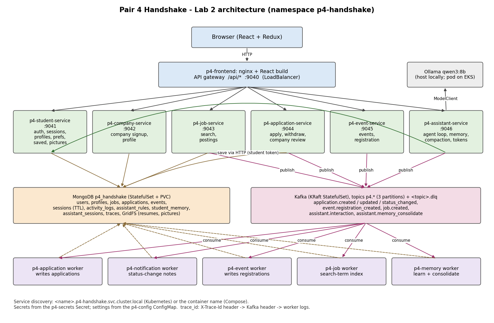
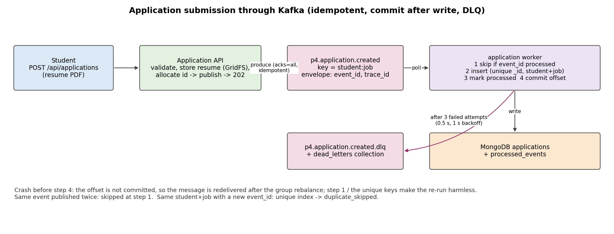

# 1. Goals

Lab 2 takes the Lab 1 Handshake platform (React, FastAPI, the hand-built
AI assistant) and runs it as a distributed system without rebuilding it:

1. Package every service, including the assistant, as a container; run the
   stack with Docker Compose; orchestrate it with Kubernetes; deploy it to
   AWS with images in ECR and the cluster on EKS (Part 1).
2. Move application submission, event registration, job creation, and
   assistant memory updates onto Kafka with idempotent workers, retries,
   and dead-letter topics (Part 2).
3. Migrate MySQL to MongoDB, keep authentication secure, and give the
   assistant three memory layers with a consolidation consumer (Part 3).
4. Move frontend state to Redux so the assistant thread survives
   navigation (Part 4).
5. Load-test the CRUD endpoints and the assistant with JMeter (Part 5).
6. Add token tracking, compaction, end-to-end tracing, eight guardrails,
   and an evaluation harness to the assistant (Part 6).

| Part | What we built | Status |
|---|---|---|
| 1 Docker, Kubernetes, AWS | 6 service images + frontend/gateway; 15-container Compose stack; K8s manifests (namespace `p4-handshake`); verified on kind and **deployed to AWS EKS with images from ECR** | Done |
| 2 Kafka | 7 topics + DLQs, producers in 4 APIs, 5 workers; 3 failure cases; flow verified on EKS | Done |
| 3 MongoDB and memory | MySQL → MongoDB migration; bcrypt + expiring sessions; 3 memory layers, `/memory`, Kafka consolidation (64 → <!-- CONSOLIDATED_COUNT --> entries) | Done |
| 4 Redux | 6 slices, thunks, selectors; the thread survives navigation | Done |
| 5 JMeter | CRUD at 100–500 users, assistant at 5–50 | <!-- JMETER_STATUS --> |
| 6 Context, guardrails, tracing | token tracking + 70% warning; compaction with recall; trace_id through Kafka; 8 guardrails; 16-case harness | Done |

# 2. Pair parameters and seed data

| Parameter | Derivation | Value |
|---|---|---|
| PAIR | assigned on Canvas | 04 |
| PORT_BASE | 9000 + PAIR × 10 | 9040 (gateway); services 9041–9046; Kafka host 9047; MongoDB host 27047 |
| Database and Kafka prefix | p{PAIR} | `p4`: database `p4_handshake`, topics `p4.*`, images/containers/ECR repositories `p4-*`, namespace `p4-handshake` |
| SEED | PAIR | 4 (seed generator, Ollama `seed`) |
| CITY_SET | assigned on Canvas | San Jose, Santa Clara, Milpitas |

| Collection | Documents | Required |
|---|---|---|
| Companies | 50 | 50 |
| Students | 200 | 200 |
| Job postings | 320 | 300 |
| Applications | 1,500 | 1,500 |
| Events | 110 | 100 |
| Event registrations (eligible only) | 600 | — |
| Student preferences | 140 | — |
| Learned memory entries (demo student) | 64 | — |

`database/seed/generate_seed.py` writes MongoDB directly and draws every
random value from `random.Random(SEED=4)`. Every seeded account's password
is `Pair4Demo!` (stored as a bcrypt hash); the demo accounts are
`demo.student@example.edu`, `noprefs.student@example.edu`, and
`demo.company@example.com`.

# 3. System design

{width=100%}

- **One code base, six services.** `backend/app` holds the routes,
  security, messaging, and assistant. `app/services/<name>.py` builds a
  FastAPI app with only that service's routers (`factory.py` adds health
  endpoints, CORS, and the tracing middleware). `app.main` mounts all
  routers in one process for local development and tests.

| Service | Port | Owns |
|---|---|---|
| Student | 9041 | sign-up, sign-in/out, sessions, profiles, preferences, saved items, student directory |
| Company | 9042 | company sign-up, company profile, students tab for employers |
| Job | 9043 | job search and details, employer job postings (publishes `job.created`) |
| Application | 9044 | submissions and withdrawals (publish to Kafka, answer 202), employer status changes, resume preview |
| Event | 9045 | event search, registration (Kafka), employer events and registrants |
| Assistant | 9046 | `/assistant/*`: agent loop, memory, compaction, tracing |
| Frontend / gateway | 9040 | nginx: React build + `/api/<path>` routing to the owning service |

- **Gateway.** The frontend container is nginx serving the React build and
  routing `/api/<path>` to the owning service by name (Compose DNS or
  Kubernetes service discovery). Routing under `/api` keeps React routes
  such as `/employer/jobs` from colliding with API paths.
- **Service-to-service call.** The assistant's `save_job_or_event` tool
  calls `POST /saved` on the Student service with the student's own
  token and `X-Trace-Id`, so the Student service's authorization applies
  to the assistant too. The read-only tools query MongoDB directly.
- **Files.** Resumes and pictures moved from the container disk to
  MongoDB GridFS so every replica sees them.
- **Model.** Ollama runs outside the API containers: on the host for
  Compose and kind, and as its own Deployment inside EKS.

# 4. Part 1 — Docker, Kubernetes, and AWS

## 4.1 Dockerfiles

`backend/docker/Dockerfile.{student,company,job,application,event,assistant}`
each install only `requirements/base.txt` (the assistant adds `httpx`),
copy `app/`, run as a non-root user, `EXPOSE` the service port, define a
`HEALTHCHECK` on `/health`, and start
`uvicorn app.services.<name>:app`. `frontend/docker/Dockerfile` is a
two-stage build (Node → nginx) with the gateway template.

<!-- DOCKERFILE -->

Images: `p4-{student,company,job,application,event,assistant}-service:2.0`
(314–316 MB) and `p4-frontend:2.0` (77 MB).

## 4.2 Docker Compose

`docker-compose.yml` runs 15 containers on network `p4-net`: MongoDB 7
(volume `p4-mongo-data`), Kafka 3.8 in KRaft mode, a one-shot topic
creator, the six services, five workers (each reuses its service's image
with `python -m app.workers.runner <name>`), and the frontend. Secrets
come from the git-ignored `.env` (`${MONGO_PASSWORD:?}` fails fast if
missing); Ollama is reached at `host.docker.internal`.

<!-- COMPOSE_PS -->

## 4.3 Kubernetes manifests

`k8s/base`: namespace `p4-handshake`; ConfigMap `p4-config` (Kafka and
service addresses as `<name>.p4-handshake.svc.cluster.local`); MongoDB
and Kafka StatefulSets with PVCs; Job `p4-kafka-topics`; six Deployments
+ ClusterIP Services (2 replicas except company, CPU/memory requests and
limits, readiness `/health/ready`, liveness `/health`); five worker
Deployments; the frontend Deployment with a `LoadBalancer` Service; HPAs
for the student, job, and application services (70% CPU, 2–5 replicas).
The Secret `p4-secrets` is created from `.env` by
`scripts/k8s_secrets.sh`; only a template with placeholder values is
committed. Overlays: `local` (kind; host Ollama, NodePort 30940) and
`aws` (ECR image names, in-cluster Ollama, gp3 storage class, load
balancer idle timeout, single-node sizing).

Verified first on a two-node kind cluster (`docs/evidence/k8s_local_kind.txt`):

<!-- K8S_EVIDENCE -->

Two problems we hit on the laptop cluster and fixed: workers restarted 3
times while Kafka was starting (they now simply restart until it is up),
and a `mongosh` readiness probe timed out under model CPU load, which
removed MongoDB's DNS record and made every API pod restart. The probe
is now a TCP check and the headless Service publishes not-ready
addresses.

## 4.4 AWS ECR and EKS deployment

**Steps** (all in the repository; every command is in `RUN_LOG.txt`):

```text
$ aws configure                                   # IAM user p4-lab2, region us-west-2
$ eksctl create cluster -f k8s/eks-cluster.yaml   # EKS 1.31, managed node group p4-nodes
$ ./scripts/aws_push_ecr.sh                       # creates 7 p4-* ECR repos, pushes linux/amd64 tag 2.0
$ ECR_REGISTRY=<account>.dkr.ecr.us-west-2.amazonaws.com ./scripts/aws_deploy_eks.sh
      # Secret from .env, kubectl apply -k k8s/overlays/aws, Kafka topics, seed, prints the URL
$ ./scripts/aws_pause.sh pause|resume             # scale the node group to 0 and back for the demo
```

**Sizing.** The AWS account's EC2 quota was 5 vCPUs (new-account
default; an increase to 16 was requested and is under review), so the
cluster is one `m7i.xlarge` node (4 vCPU, 16 GiB) that runs everything:
the six services (2 replicas each, company 1), five workers, Kafka,
MongoDB, the frontend, and Ollama. The `aws` overlay lowers CPU requests
(limits unchanged) so all 22 pods schedule, and uses `qwen3:1.7b` with
reasoning off: on this node Ollama gets 2 physical cores, and `qwen3:4b`
took about 3.5 minutes per model call, past the 240 s request deadline.
The trade-off is reliability: an answer takes about 3 minutes on AWS, and
the small model sometimes produces tool calls that fail validation twice,
so the loop stops with "I couldn't complete that request reliably"
(guardrails 7 and 8 working as designed) instead of answering. The same
images with `qwen3:8b` (local runs, sections 9 and 10) do not show this.
With the requested 16-vCPU quota the `aws` overlay would add a separate
model node and go back to `qwen3:8b`.

**Problems found on EKS and fixed in the manifests:**

| Problem | Cause | Fix |
|---|---|---|
| MongoDB and Kafka PVCs stayed `Pending` | EKS 1.30+ has no default StorageClass | `k8s/overlays/aws/storageclass.yaml`: default `gp3` on the EBS CSI driver |
| Kafka crashed: cannot write `meta.properties` | the fresh EBS volume is owned by root; the image runs as uid 1000; ext4 root holds `lost+found` | `securityContext.fsGroup: 1000` and `KAFKA_LOG_DIRS=/var/lib/kafka/data/logs` |
| Assistant requests cut at exactly 60 s | AWS load balancer idle timeout default | Service annotation `aws-load-balancer-connection-idle-timeout: "600"` (same as nginx) |
| New Ollama pod `Pending` during a rollout | one node cannot hold the old and new pod together | `strategy: Recreate` for Ollama |
| HPAs showed `<unknown>` CPU | a second metrics-server install broke the EKS add-on's Service | restored the EKS `metrics-server` add-on |

<!-- AWS_EVIDENCE -->

<!-- AWS_SCREENSHOTS -->

## 4.5 How the services communicate and scale

- **Discovery.** Every service, worker, and the gateway reach each other
  by Kubernetes DNS (`p4-<name>.p4-handshake.svc.cluster.local`), set in
  the ConfigMap; nothing uses pod IPs. Only the frontend Service is
  public (a `LoadBalancer`); MongoDB, Kafka, Ollama, and the APIs are
  `ClusterIP`.
- **Configuration and secrets.** Non-secret settings come from the
  ConfigMap; `MONGO_PASSWORD`, `MONGO_URI`, and `JWT_SECRET_KEY` come from
  the `p4-secrets` Secret created from the git-ignored `.env`.
- **Stateless APIs.** Sessions, conversations, files (GridFS), and memory
  live in MongoDB, so any replica can serve any request and the HPAs can
  add pods under CPU load (70% target, 2–5 replicas).
- **Workers.** Replicas of a worker join one consumer group and split the
  3 partitions of each topic, so up to 3 replicas per topic do useful
  work; offsets are committed only after the write, so a lost pod's
  messages are re-read by another replica.

# 5. Part 2 — Kafka

{width=100%}

| Topic | Producer | Consumer |
|---|---|---|
| `p4.application.created` / `.updated` | Application API (`POST /applications`, `/withdraw`) | application worker |
| `p4.application.status_changed` | Application API (company `PATCH .../status`) | notification worker |
| `p4.event.registration_created` | Event API (`POST /events/{id}/register`) | event worker |
| `p4.job.created` | Job API (`POST /employer/jobs`) | job worker (search-term index) |
| `p4.assistant.interaction` | Assistant API (every chat) | memory worker (learns entries) |
| `p4.assistant.memory_consolidate` | Assistant `/memory consolidate` | memory worker (consolidation) |

Kafka runs inside the cluster (StatefulSet `p4-kafka`, KRaft mode, 3
partitions per topic, a `.dlq` topic for each). Each message is a JSON
envelope (`event_id`, `type`, `occurred_at`, `trace_id`, `payload`)
keyed by `student:job` (or `student:event`) so retries for one pair stay
in order on one partition. The producer uses `enable.idempotence=true`
and `acks=all`. The API answers **202 Accepted** after Kafka acknowledges;
the worker writes MongoDB.

Consumers (`app/workers/runner.py`) run with `enable.auto.commit=false`
and commit each offset only after the handler returns. Handlers are
idempotent: an `event_id` already in `processed_events` is skipped, and
writes use unique keys (`_id` = pre-allocated id, unique
`student_id+job_id`).

## 5.1 Message flow on AWS

<!-- FIG:aws_kafka_flow|Kafka message flow on EKS: 202 from the API, the worker consumes p4.application.created with the same trace id, the application is stored, and the consumer group has lag 0|100 -->

<!-- AWS_KAFKA -->

## 5.2 Failure cases (full output: `docs/evidence/kafka_failures.log`)

<!-- KAFKA_FAILURES -->

# 6. Part 3 — MongoDB and agent memory

## 6.1 Migration and schema

| MySQL table (Lab 1) | MongoDB collection | Notes |
|---|---|---|
| users | `users` | `_id` = Lab 1 id; unique `email`; bcrypt `password_hash` |
| student_profiles + student_skills | `student_profiles` | `_id` = user id; `skills` embedded as names |
| company_profiles | `company_profiles` | `_id` = user id |
| jobs + job_skills | `jobs` | `company_name` and `skills` embedded for search |
| applications | `applications` | unique (`student_id`, `job_id`); resume PDF in GridFS `resumes` |
| events | `events` | `company_name` embedded |
| event_registrations | `event_registrations` | unique (`student_id`, `event_id`) |
| student_preferences | `student_preferences` | `_id` = student id |
| saved_items | `saved_items` | unique (`student_id`, `item_type`, `item_id`) |
| — | `sessions` | sign-in sessions, TTL index on `expires_at` |
| — | `activity_logs` | signups, logins, applications, registrations, saves (with trace_id) |
| — | `assistant_rules`, `student_memory`, `assistant_sessions` | memory layers 1–3 |
| — | `notifications`, `processed_events`, `dead_letters`, `traces`, `counters` | Kafka and observability |

Integer ids are kept (allocated atomically from `counters`), so the API
and the React app did not change. Dates are ISO strings so range filters
are plain comparisons. `database/migrate_mysql_to_mongo.py` copied the
real Lab 1 MySQL database with the same converter the seed generator uses:

<!-- MIGRATION -->

**Security.** Passwords stay bcrypt hashes (12 rounds for new accounts).
Signing in creates a `sessions` document with `expires_at` (60 min) and a
JWT that carries the session id; every request checks the session, so
`POST /auth/logout` and expiry invalidate the token immediately (tests
`test_logout_ends_the_session`, `test_expired_session_is_rejected`).

## 6.2 Three memory layers

| Layer | Collection | Contents | Lifetime |
|---|---|---|---|
| Instructions | `assistant_rules` | 5 rules: never reveal another student's data, always state eligibility, label hourly/yearly pay, save only after confirmation, saved preferences and tool results win over memory | permanent |
| Learned | `student_memory` | one entry per fact: `date | category | description` | until consolidated or cleared |
| Session | `assistant_sessions` (the handout's `conversations` layer) | the current conversation, pending confirmation, token usage | 4 h TTL; deleted by "New chat"; compacted when long |

`prompt_block()` appends the rules and the student's newest 40 memory
entries to the system prompt. The memory worker learns entries from each
request (`assistant.interaction`), e.g. "I prefer hybrid roles" →
`preference`. `/memory` lists entries; `/memory add`, `/memory rules`,
`/memory clear`, and `/memory consolidate` (publishes to Kafka) are the
other commands.

<!-- FIG:assistant_memory|The /memory command lists the demo student's learned entries (after consolidation)|90 -->

## 6.3 Consolidation (Kafka consumer)

The demo student has 64 entries with 5 deliberate contradictions (remote
→ onsite, San Jose → Milpitas, May 2027 → December 2026 graduation, no
finance → open to fintech, $30 → $35/hr), 3 duplicate groups (7 entries),
11 single-skill entries, and 25 activity entries. `/memory consolidate`
publishes `p4.assistant.memory_consolidate`; the memory worker asks the
model for a consolidated list, `verify_consolidation` checks it (fewer
than 40, no duplicates, every contradiction resolved to the newest value),
and the rule-based pass corrects whatever the model got wrong. The result
is verified again before it is stored.

<!-- CONSOLIDATION -->

# 7. Part 4 — Redux

`frontend/src/store`: `configureStore` with six slices — `auth` (token,
role, expiry; `login`/`logout` thunks, logout ends the server session),
`jobs` (filters, results, selected job, details cache, **companies**
collected from job details), `applications` (list, status filter,
submit/withdraw thunks with the 202 answer), `events` (filters, events,
**registrations**, register thunk), `saved` (saved jobs/events, save and
remove thunks), and `assistant` (conversation id, messages, pending
confirmation, token usage, trace id). Pages read state with selectors
(`selectJobResults`, `selectSelectedJob`, `selectAppliedJobIds`,
`selectRegistrations`, `selectIsSaved(type, id)`,
`selectContextWarning`, …) and change it only by dispatching actions.
`useAuth()` keeps its Lab 1 interface but is backed by the auth slice.

The conversation lives in the store (mirrored to `sessionStorage`), not
in the Assistant page, so leaving the page — even while a request is in
flight — and coming back keeps the thread. Redux DevTools is enabled
(`devTools: {name: "Pair 4 Handshake"}`).

The screenshots below were taken with a headless browser. Instead of the
DevTools extension window, the right-hand panel lists the real action log
and state, recorded through the same hook the extension uses
(`window.__REDUX_DEVTOOLS_EXTENSION_COMPOSE__`) while we clicked through
the app; the token is shortened before display.

<!-- FIG:redux_auth_jobs_saved|Redux actions and state after signing in, searching, saving a job, and opening Applications, Events, and Home: auth, jobs, applications, events, and saved slices|100 -->

<!-- FIG:redux_assistant|Assistant slice after a question, a trip to Jobs, and back: the same conversation id and messages|100 -->

<!-- FIG:assistant_after_navigation|The thread is still there after leaving the assistant for the Jobs page and returning|90 -->

<!-- REDUX_SCREENSHOTS -->

# 8. Part 5 — JMeter performance testing

Plan `loadtest/p4_handshake.jmx` (generated by `build_plan.py`): one
thread group per endpoint, enabled by a `-J<endpoint>_threads=N`
property; 2 s ramp-up so all users are active together; login users
repeat 5 times and search users 20 times; each application user signs
in once and submits one new application (fresh student/job pairs from
`prepare_data.py`); assistant users send one chat each with a 15-minute
timeout and a JSON assertion on `$.status`. All requests go through the
gateway on port 9040 against the Compose stack (2 uvicorn workers per
service) on one laptop, with JMeter on the same machine.

<!-- JMETER -->

# 9. Part 6 — Context management, guardrails, observability

## 9.1 Token tracking

After every model call the loop records Ollama's `prompt_eval_count`
and `eval_count` (or an estimate for scripted models). Each answer
returns `usage` (prompt and completion tokens, context window 12,288,
context %), the UI shows a meter, and above 70% it warns and suggests
`/compact`.

<!-- FIG:assistant_answer|An assistant answer with the token meter (prompt/completion tokens and context %) under the reply|90 -->

## 9.2 Compaction and recall

<!-- COMPACTION -->

## 9.3 Tracing

<!-- TRACING -->

## 9.4 Guardrails

| # | Guardrail | Enforced in |
|--|----------------|------------------------------------------------------|
| 1 | Tool allowlist | `validate_arguments` rejects unknown names (`tools.py`) |
| 2 | Schema validation | types, enums, required, and **extra** arguments rejected before execution (`tools.py`) |
| 3 | Authorization | `require_student` on every assistant route; tools act only for `ctx.student_id`; the save goes through the Student service with the student's token; conversations are owner-only (`assistant_routes.py`, `security.py`) |
| 4 | Read/write control | read-only tools run directly; `save_job_or_event` passes `confirm_action` (`confirm.py`) |
| 5 | Prompt-injection defense | database text fenced as untrusted data, delimiters neutralized, rule 7 (`tools.py`, `agent.py`) |
| 6 | Privacy and secrets | rule 8; `redact()` removes other students' `.edu` emails, JWTs, bearer tokens, API keys, `password=` values from answers and logged arguments (`guardrails.py`) |
| 7 | Bounded execution | `MAX_ITERATIONS=6`, per-call HTTP timeout, 240 s request deadline, one repair per failure (max 2), one retry per tool error (`agent.py`) |
| 8 | Reliable answers | tools return explicit no-match / error text; rule 1; data questions must call a tool (`agent.py`) |

<!-- FIG:assistant_confirmation|Read/write control in the UI: the save waits for the student's Yes / No|90 -->

## 9.5 Evaluation harness

`cd backend && KAFKA_ENABLED=false .venv/bin/python -m harness.agent_harness`
runs 16 cases with scripted models through the production loop,
validation, confirmation, tool, redaction, and HTTP authorization code,
and writes `docs/evaluation/agent_harness.json` (input, assistant
messages, tool names/arguments/results, final answer, guardrail outcome,
failures, repairs, retries, iteration and tool-call counts, elapsed time
per case) and `agent_harness.md`.

<!-- HARNESS -->

# 10. Application screenshots

The same images run in Compose, on kind, and on EKS. These screenshots
come from the local Compose stack (through the nginx gateway on port
9040), which uses the full `qwen3:8b` model; section 4.4 shows the AWS
deployment.

<!-- FIG:login|Sign-in page served by the nginx gateway|60 -->

<!-- FIG:student_dashboard_saved|Student dashboard with the Saved items panel (saved jobs and events from the saved slice)|90 -->

<!-- FIG:student_jobs_saved|Job search with the details panel; "Save" stores the job through the Student service|90 -->

<!-- FIG:student_applications|My Applications: submissions stored by the application worker after Kafka|90 -->

<!-- FIG:student_events|Upcoming events with eligibility-aware Register buttons (registration goes through Kafka)|90 -->

<!-- FIG:company_dashboard|Company dashboard|90 -->

<!-- FIG:company_jobs|Company job postings (new postings publish p4.job.created)|90 -->

<!-- FIG:company_applications|Company applicant list; status changes publish p4.application.status_changed|90 -->

<!-- FIG:company_events|Company events and registrants|90 -->

<!-- FIG:swagger_application_service|Swagger UI of the Application service on its own port (9044)|90 -->

<!-- FIG:swagger_assistant_service|Swagger UI of the Assistant service (9046)|90 -->

# 11. Code walkthrough

The snippets below are extracted from the repository when this report is
built, so they match the submitted code.

<!-- CODE -->

# 12. Terminal output

<!-- TERMINAL -->

# 13. AI use

See `AI_USE.md` (Lab 2 section): incorrect outputs of the coding
assistant, how each was detected, and the fix. METRICS.md and RUN_LOG.txt
have the Lab 2 measurements and every command we ran.

# Appendix A: Git commit history

<!-- GIT_HISTORY -->
